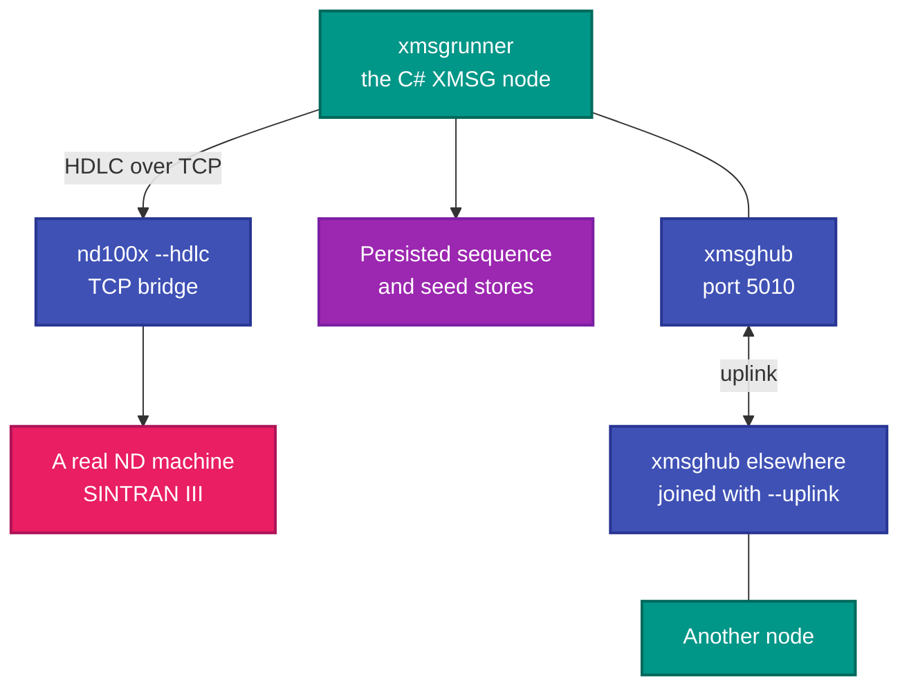
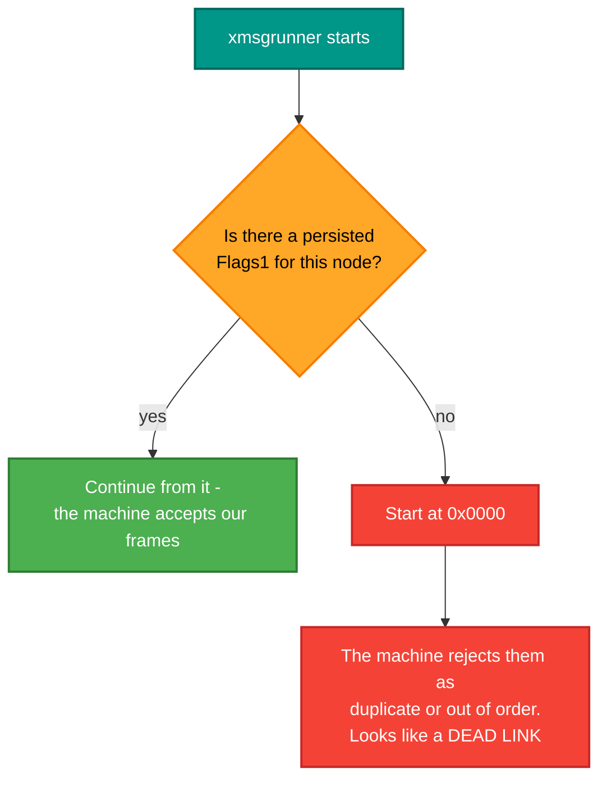

# RetroXmsg

**Talk to a Norsk Data machine.** Two applications: a hub that links XMSG nodes over TCP, and a runner that drives
the C# XMSG stack against a real SINTRAN III machine — file transfer, folder synchronisation, chat and terminal
sessions.

## Why this repo exists

XMSG is the messaging system SINTRAN III and COSMOS are built on. File transfer, terminal access, the name service,
remote procedure calls — all of them are XMSG messages with a different service number. So reaching an ND machine
for almost any purpose means speaking XMSG.

The protocol work is in [RetroIO](https://github.com/RetroCoreLabs/RetroIO) and consumed here as packages. This
repository is the two programs that *use* it: one to connect nodes to each other, one to connect to a machine.

The hard part is not the message format — it is **continuity**. SINTRAN keeps a persistent outgoing datagram
sequence per remote node and expects ours to continue across our process restarts. Get that wrong and the machine
rejects our frames as duplicates, which looks exactly like a dead link. That is why the runner persists its
sequence, and why this is a real program rather than a script.

## The two applications

| Application | What it is | README |
|---|---|---|
| `xmsghub` | Links XMSG nodes over TCP; hubs can chain | [README](src/RetroXmsg.Hub/README.md) |
| `xmsgrunner` | Drives the stack against a real machine: push, pull, sync, chat, relay | [README](src/RetroXmsg.Runner/README.md) |

---

## Prerequisites

| # | Requirement | Needed for | How to check |
|---|---|---|---|
| P1 | .NET SDK as pinned in `global.json` | Everything | `dotnet --info` |
| P2 | PowerShell 7+ | `build.ps1` | `$PSVersionTable.PSVersion` |
| P3 | **RetroIO packed to the local feed** (`../localfeed`, beside the repositories) | Restore | `dir ..\localfeed` |
| P4 | A free TCP port for the hub | `xmsghub` | `netstat -ano \| findstr <port>`; `--port 0` picks one |
| P5 | **A reachable `nd100x --hdlc` bridge** | `xmsgrunner` against a machine | The emulator or the real thing |
| P6 | A `topology.json` | `xmsgrunner` | Shipped next to the exe, or `--config` |
| P7 | A writable directory | The persisted sequence and seed stores | One small text file each |
| P8 | A real ND machine or an emulator | An end-to-end run | Record as SKIPPED if unavailable |

```powershell
# from the repository root
.\build.ps1
publish\win-x64\xmsghub.exe --port 5010
publish\win-x64\xmsgrunner.exe --self 103 --for 60
```

---

## Two traps before you start

> **1. A hub from the OLD build is live.** `xmsghub.exe` PID 53356 has been listening on port **5010** since
> 2026-09-02, from the pre-migration tree, with machines connected. **Do not kill it and do not start a hub on
> 5010.** The cutover to the new build is migration step 4b and is still open.

> **2. Only one XMSG runner may hold system number 19999.** Two processes sharing it leave one permanently behind,
> and the symptom reads exactly like a dead file server. Check before starting.

Both are recorded the same way in the migration notes, in `Manual tests - START HERE.md`.

---

## How the pieces connect



## Why the sequence must persist



This is the single most useful thing to know about running against real hardware. See
`RetroIO.Protocols.Xmsg.Node` (`RetroIO/src/RetroIO.Protocols.Xmsg.Node/README.md`).

---

## Tests

The protocol is tested in RetroIO — nine `Xmsg.*` test projects, with shared fixtures in
`tests/RetroIO.Protocols.Xmsg.TestSupport`, and codec tests that run against **real captured frames**. That is the
right place for it: these are applications.

Manual test procedures, including the lab cases, are in the migration notes, as `Manual tests - RetroXmsg.md`.

To drive a SINTRAN console, use the **retroterm MCP** rather than hand-rolling telnet — open one session and keep
it, because reconnecting mid-program hangs the line.

## Conventions

- Names follow the workspace naming standard; diagrams follow the workspace Mermaid palette. Both live one level
  up in the workspace root, **outside this repository**, so they are paths rather than links: `NAMING.md` and
  `MERMAID_COLOR_STANDARDS.md`.
- `python eng/check-docs.py` checks every link and diagram here.
- The org is **RetroCoreLabs**. `HackerCorpLabs` is retired.
