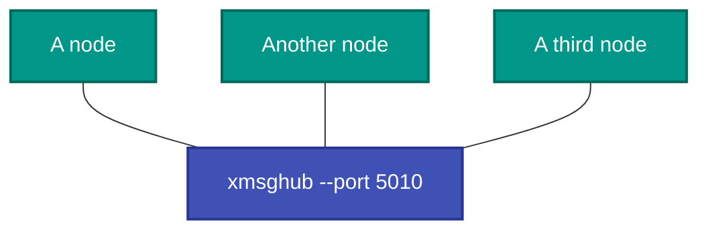
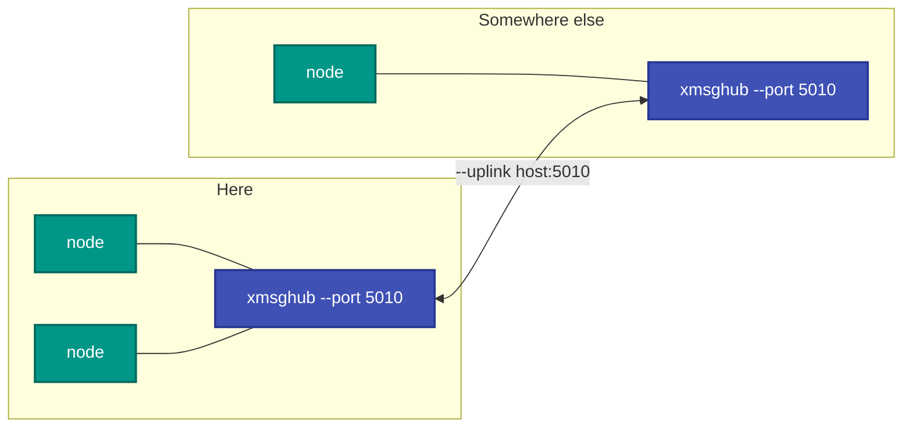

# xmsghub — the XMSG hub

## What it is

A hub that links XMSG nodes over TCP. Nodes connect to it; it carries their traffic to each other. Hubs can also
**chain** — one hub joins another with `--uplink` — so separate groups of nodes become one network.

## Why you need it

XMSG nodes expect a link to each other. On real hardware that link is a serial line or an Ethernet segment; between
programs on modern machines it has to be something, and a hub is the simplest something that scales past two.

Without one, every node needs a direct link to every other node. With one, each node has a single connection and the
hub does the rest — which is what makes a three- or four-node test practical rather than a wiring exercise.

`--uplink` exists for the case that turns up as soon as more than one person is involved: two groups of nodes, each
with a hub, that need to reach each other. Chaining hubs joins them without re-pointing any node.

## What you can use it for

- Connecting several XMSG nodes without wiring each pair.
- **Joining two hubs** so two groups become one network.
- Running a test network on one machine — `--port 0` picks a free port, so nothing collides.
- Running quietly in the background (`--quiet`) when it is infrastructure rather than the thing under test.

## Prerequisites

| # | Requirement | Why | How to check |
|---|---|---|---|
| P1 | .NET SDK as pinned in `global.json`, or the published exe | To build or run | `dotnet --info` |
| P2 | RetroIO packed to the local feed | Restore | `dir ..\localfeed` |
| P3 | **A free TCP port** | It listens | `netstat -ano \| findstr <port>`; or `--port 0` |
| P4 | Nodes to connect | Anything useful | `xmsgrunner`, or another hub |
| P5 | A reachable remote hub | `--uplink` only | Optional |

> **Do not start a hub on port 5010.** A hub from the pre-migration build has been listening there since
> 2026-09-02 with machines connected, and the cutover is still open. Use another port.

## Usage

```
xmsghub --port N [--uplink host:port] [--quiet]
```

| Option | Meaning |
|---|---|
| `--port N` | The port to listen on. **0 picks a free port.** Must be 0-65535 |
| `--uplink host:port` | Also join a remote hub, chaining the two |
| `--quiet` | Less output |

```powershell
xmsghub --port 5010                       # a hub on port 5010
xmsghub --port 5010 --uplink host:5010    # and join a remote hub
xmsghub --port 0                          # pick a free port
```

A bad `--port` or a malformed `--uplink` is rejected with a message naming the problem, not a stack trace.

## One hub



Each node has **one** connection. Without the hub, three nodes need three links; four need six.

## Two hubs, chained



No node is reconfigured. The uplink is the only new connection.

## Related

- [`xmsgrunner`](../RetroXmsg.Runner/README.md) — the node that does the work.
- `RetroIO.Protocols.Xmsg.Node` (`RetroIO/src/RetroIO.Protocols.Xmsg.Node/README.md`) — the node state,
  the relay, and why the sequence must persist.
