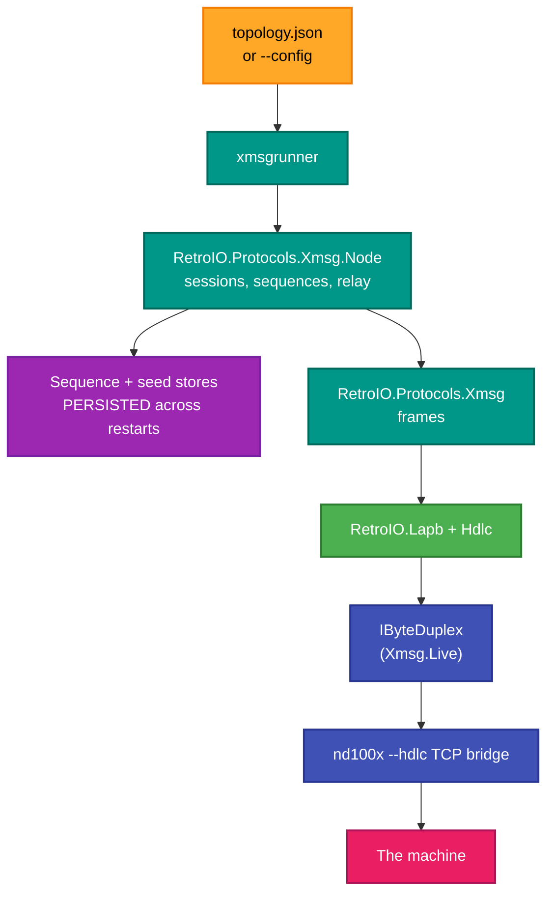
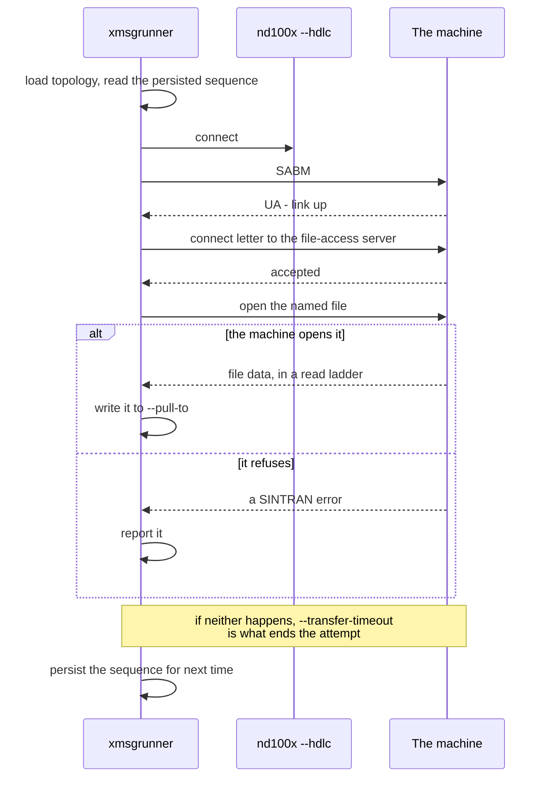

# xmsgrunner — the live XMSG node

<!-- A still screenshot of RetroXmsg.Runner doing its job. PNG, under 10 MB. Uncomment when
     the capture exists; keep the alt text, it is all a screen reader gets.

-->

## What it is

The program that talks to a real Norsk Data machine. It connects the C# XMSG stack to an `nd100x --hdlc` TCP bridge,
brings up the link, and then does useful work over it: **push** and **pull** files, **sync** folders, **chat**,
**relay** between links, and a number of diagnostic operations.

## Why you need it

This is the end of the chain. Everything else — the codec, the kernel API, the node, the servers — exists so that
this can move a file to or from a machine built in 1985.

It is also where the **real-hardware** problems live, and they are not protocol problems:

- **The datagram sequence must survive our restarts.** SINTRAN keeps a persistent outgoing sequence per remote node
  and expects ours to continue. Start again at zero and the machine rejects our frames as duplicates — which looks
  like a dead link, not a numbering fault. The runner persists it.
- **A transfer needs a deadline.** `--transfer-timeout` exists because a `--pull` for a file the machine will not
  open holds the seam until something gives up. That was measured on 2026-08-18, and the run held until the `--for`
  window expired.
- **One thing at a time.** `--push` and `--pull` cannot run together; run one, then the other.

## What you can use it for

- **Pulling a file off a machine** (`--pull`, `--pull-from`, `--pull-to`).
- **Pushing one to it** (`--push`, `--push-to`, `--push-as`, `--push-overwrite`).
- **Synchronising a folder** (`--sync`, `--sync-pull`, `--sync-root`, `--sync-to`, `--sync-user`).
- **Chat** against a service (`--chat-service`, `--chat-room`, `--chat-to`, `--chat-lines`, `--chat-load`).
- **Relaying** between links (`--relay-listen`, `--relay-inbound-node`).
- Diagnostics: `--trace-frames`, `--fa-probe-without-open`, `--request-link`, `--announce-restart`,
  `--resync-hard`, `--originate-from-seed`.
- Batch work (`--append-batch`, `--append-batch-out`, `--batch-to`).

## Prerequisites

| # | Requirement | Why | How to check |
|---|---|---|---|
| P1 | .NET SDK as pinned in `global.json`, or the published exe | To build or run | `dotnet --info` |
| P2 | RetroIO packed to the local feed | Restore | `dir ..\localfeed` |
| P3 | **A reachable `nd100x --hdlc` TCP bridge** | Anything live | The emulator, or the real machine |
| P4 | A `topology.json` | Node identities and aliases | Shipped beside the exe, or `--config` |
| P5 | **A writable directory for the sequence and seed stores** | Correctness across restarts | One small text file each |
| P6 | A `--for` window | Anything one-shot | Otherwise it runs until stopped |
| P7 | **System number 19999 free** | Only one runner may hold it | Two processes sharing it leave one behind permanently |
| P8 | A real machine or an emulator | An end-to-end run | Record as SKIPPED if unavailable |

> **Only one runner may hold system number 19999.** Two processes sharing it leave one permanently behind, and the
> symptom reads exactly like a dead file server. Check before starting.

## Usage

```
xmsgrunner [legacy] [host] [port] [nodeDecimal] [seconds]
xmsgrunner --self <id|alias> --for <seconds> [operation options]
```

Positional arguments are the legacy form. The named options are the current one.

| Option | Meaning |
|---|---|
| `--config <path>` | The topology file. **Wins over** the `topology.json` beside the exe |
| `--self <id\|alias>` | Our own node. Precedence: `--self` > the positional node argument > `topology.self` > **103** |
| `--for <seconds>` | How long to run |
| `--transfer-timeout <s>` | How long a one-shot `--push`/`--pull` may take before giving up |
| `--trace-frames` | Log the frames |

### Files

| Option | Meaning |
|---|---|
| `--pull`, `--pull-from`, `--pull-to` | `--pull` names the file **on the machine**; `--pull-to` where to put it here |
| `--push`, `--push-to`, `--push-as`, `--push-overwrite` | The other direction |

### Folders, chat, relay

| Option | Meaning |
|---|---|
| `--sync`, `--sync-pull`, `--sync-root`, `--sync-to`, `--sync-user` | Folder synchronisation |
| `--chat-service`, `--chat-room`, `--chat-to`, `--chat-lines`, `--chat-load` | Chat |
| `--relay-listen`, `--relay-inbound-node` | Relay between links |

### Diagnostics

`--fa-probe-without-open`, `--request-link`, `--announce-restart`, `--resync-hard`, `--originate-from-seed`,
`--append-batch`, `--append-batch-out`, `--batch-to`.

> **`--push` is not wired to the relay path yet** — the program says so when you try it. Two links and nothing to
> choose between them is the open part.

## Where it sits



## Pulling a file



The timeout is the branch that matters: without it, a file the machine will not open holds the seam until the
`--for` window expires — measured, and the reason the option exists.

## Related

- [`xmsghub`](../RetroXmsg.Hub/README.md) — for linking several nodes.
- `RetroIO.Protocols.Xmsg.Node` (`RetroIO/src/RetroIO.Protocols.Xmsg.Node/README.md`) — sequences, relay,
  TAD sessions.
- `RetroIO.Protocols.Xmsg.Live` (`RetroIO/src/RetroIO.Protocols.Xmsg.Live/README.md`) — the byte duplex and
  the TCP bridge transport.
- `RetroIO.Protocols.Xmsg.Sync` (`RetroIO/src/RetroIO.Protocols.Xmsg.Sync/README.md`) — the folder
  synchronisation logic behind `--sync`.
- To drive a SINTRAN console alongside this, use the **retroterm MCP** rather than hand-rolled telnet.
